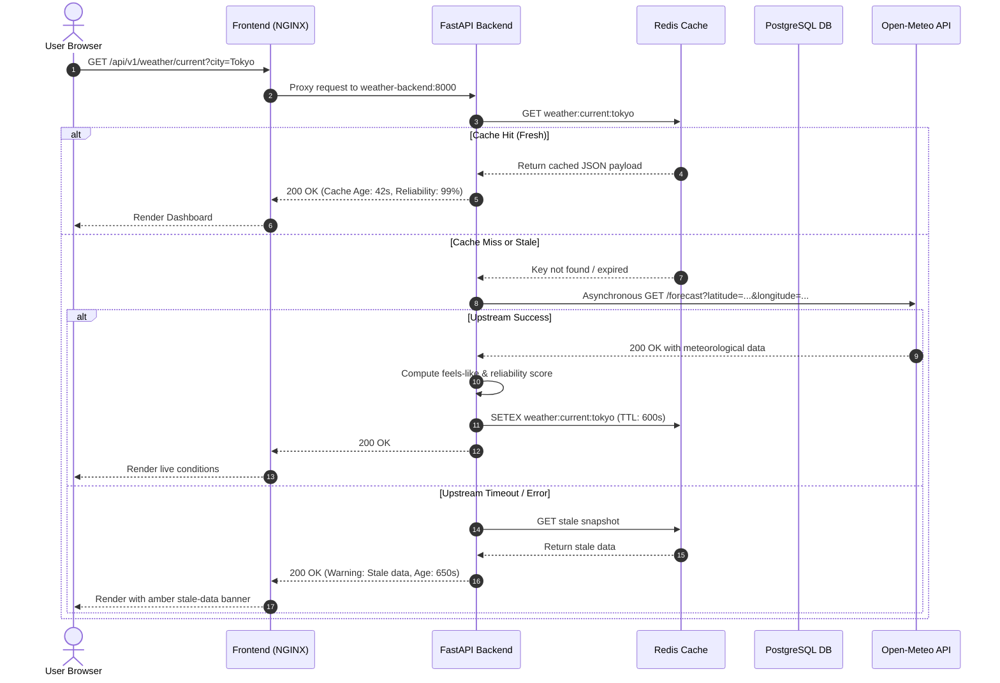
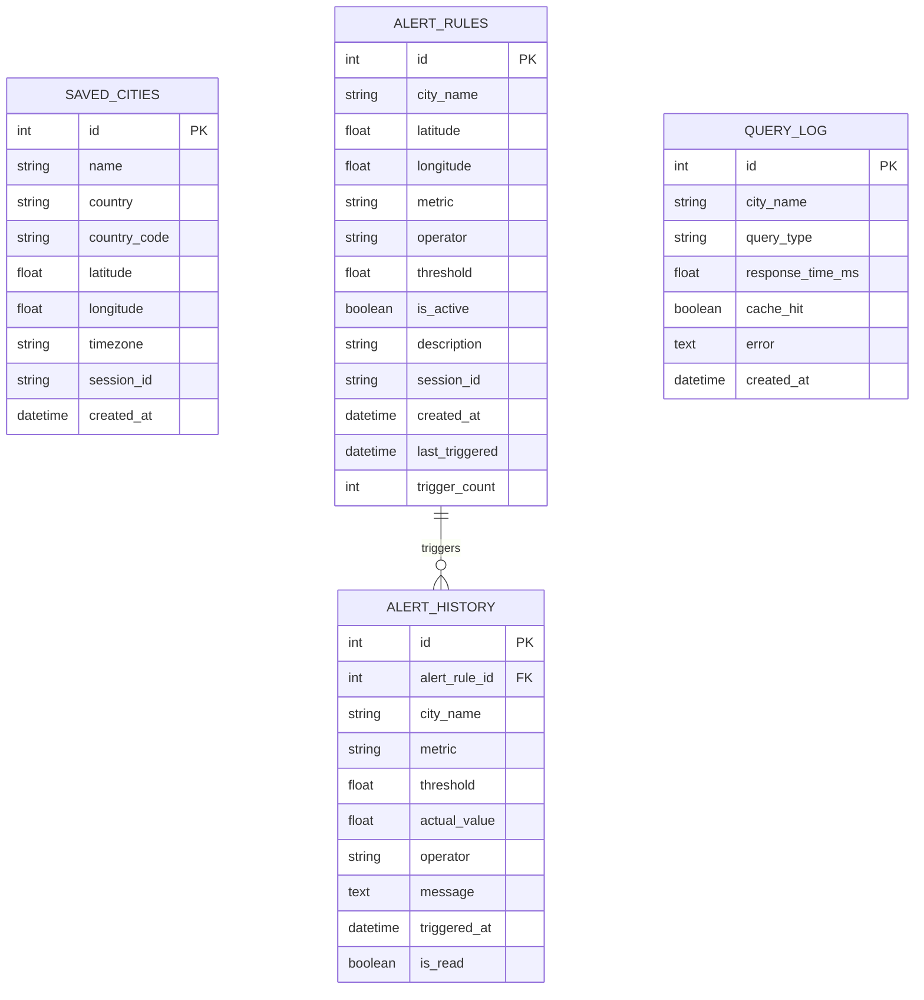

# AtmosphereX: Cloud-Native Weather & Climate Intelligence Platform

[](https://github.com/atmospherex/atmospherex/actions)
[](LICENSE)
[](https://fastapi.tiangolo.com)
[](https://react.dev)
[](https://docker.com)
[](https://kubernetes.io)

> **B.Tech Computer Science Engineering — Cloud Computing Semester Examination Project**  
> AtmosphereX is a production-grade, containerized, and Kubernetes-orchestrated weather and climate intelligence web platform that bridges modern frontend engineering with real cloud-native distributed architecture.

---

## Table of Contents
1. [Project Abstract](#1-project-abstract)
2. [Problem Statement](#2-problem-statement)
3. [Objectives](#3-objectives)
4. [Unique Features & Contributions](#4-unique-features--contributions)
5. [Technology Stack](#5-technology-stack)
6. [System Architecture](#6-system-architecture)
7. [Request & Data Flow](#7-request--data-flow)
8. [Microservices Breakdown](#8-microservices-breakdown)
9. [Database Design](#9-database-design)
10. [Docker Containerization](#10-docker-containerization)
11. [Kubernetes Orchestration](#11-kubernetes-orchestration)
12. [Local Setup Instructions (Windows & Linux)](#12-local-setup-instructions)
13. [Docker Compose Deployment](#13-docker-compose-deployment)
14. [Minikube / Kubernetes Deployment](#14-minikube--kubernetes-deployment)
15. [Environment Variables](#15-environment-variables)
16. [API Endpoints Overview](#16-api-endpoints-overview)
17. [Monitoring & Observability](#17-monitoring--observability)
18. [Automated Testing & Quality](#18-automated-testing--quality)
19. [Screenshots](#19-screenshots)
20. [Troubleshooting Guide](#20-troubleshooting-guide)
21. [Cloud Computing Concepts Demonstrated](#21-cloud-computing-concepts-demonstrated)
22. [Limitations & Future Scope](#22-limitations--future-scope)

---

## 1. Project Abstract

Traditional academic weather applications are often built as monolithic scripts fetching data from external APIs and rendering static widgets, failing to demonstrate real cloud infrastructure concepts. **AtmosphereX** addresses this educational gap by providing a fully functional, cloud-native environmental platform designed to meet semester examination benchmarks. 

Built with **React 18 (TypeScript, Vite, Tailwind CSS)** on the frontend and **Python FastAPI (SQLAlchemy, Alembic)** on the backend, AtmosphereX integrates live data from the **Open-Meteo** API without mock or hardcoded numbers. It implements asynchronous request pipelines, a multi-tier **Redis** cache with sensible TTLs, persistent **PostgreSQL** storage for alert rules and user preferences, and a scheduled background evaluation worker. 

The application is containerized with multi-stage non-root Dockerfiles and deployed via **Docker Compose** or **Kubernetes** manifests with Horizontal Pod Autoscaling (HPA), Liveness/Readiness probes, PersistentVolumeClaims, and an NGINX Ingress Controller. A built-in **Cloud Operations Center** exposes live cluster telemetry, cache hit ratios, and upstream error rates directly to the examiner.

---

## 2. Problem Statement

Most weather websites either:
1. Conflate short-term weather forecasts with long-term climate trends, misleading users on environmental shifts.
2. Suffer from single-point-of-failure architectures that collapse during upstream provider rate limits or latency spikes.
3. Lack transparent data quality metrics, presenting stale or interpolated values as real-time ground truth.
4. Fail to illustrate how modern web platforms operate as resilient, auto-scaling, distributed systems on cloud infrastructure.

**AtmosphereX** resolves these challenges by strictly separating forecast and climate domains, implementing multi-layer caching with graceful degradation, computing an explainable data reliability score, and providing full visibility into the cloud infrastructure.

---

## 3. Objectives

- **Cloud-Native Architecture**: Demonstrate real 12-Factor principles, containerization, and Kubernetes orchestration in an easily explainable codebase.
- **Genuine Environmental Intelligence**: Query real-time weather, 48-hour hourly forecasts, 7-day daily forecasts, multi-year historical climate baselines, and air quality metrics from Open-Meteo.
- **Resilience & High Availability**: Implement Redis caching with automated TTL expiry, stale data serving during upstream outages, and zero-downtime rolling updates.
- **Transparent Observability**: Expose Prometheus metrics, provision Grafana dashboards, and create an in-app Cloud Operations page reflecting live infrastructure status.
- **Comprehensive Exam Readiness**: Provide a 25+ question viva guide, demonstration script, and clear deployment recipes for any evaluator.

---

## 4. Unique Features & Contributions

### 1. Dedicated Cloud Operations Center (`/ops`)
A built-in telemetry center created specifically for examiner evaluation. It connects directly to `/api/v1/ops/status` to show live database connectivity, real Redis cache hit-rates, upstream API request counters, and deployment mode detection (`Kubernetes`, `Docker Compose`, or `Local Mode`). It never fabricates simulated pod metrics.

### 2. Explainable Data Reliability Score
An algorithmic score (0–100%) that dynamically evaluates response freshness and completeness. It calculates age decay (-1 pt/min) and penalizes missing core parameters (temperature, humidity, wind, pressure).

### 3. Clear Weather vs. Climate Separation
Short-term forecasts are strictly limited to probabilistic 7–16 day windows. Climate analysis computes multi-year historical means (1–10 years) with an explicit baseline notice: *"Observed historical data only; not a climate projection."*

### 4. Smart Weather Planner
Context-aware outdoor recommendations based on deterministic meteorological thresholds (running suitability, cycling safety, UV protection, rain gear, and heat precautions).

### 5. Multi-City Concurrency Engine
Side-by-side comparison of up to 4 cities queried concurrently via Python's asynchronous `asyncio.gather`, reducing total latency to that of a single network hop.

### 6. Graceful Degradation & Stale Cache Warning
If the upstream weather provider times out or fails, AtmosphereX automatically serves the cached snapshot with an `X-Cache-Age` indicator and an amber UI banner.

---

## 5. Technology Stack

| Layer | Technology | Version | Purpose |
|-------|------------|---------|---------|
| **Frontend Framework** | React + Vite + TypeScript | React 18.3, Vite 5.4, TS 5.5 | High-performance SPA with strict typing |
| **Styling & UI** | Tailwind CSS + Lucide Icons | Tailwind 3.4, Lucide 0.44 | Custom dark navy aurora glassmorphism design system |
| **Data Visualization** | Recharts | 2.12.7 | Responsive SVG area charts, bar graphs, and line trends |
| **Interactive Maps** | Leaflet + OpenStreetMap | 1.9.4 | Inverted dark-mode world map with clickable pins |
| **State Management** | Zustand | 5.0 | Lightweight persisted client state |
| **Backend Framework** | Python FastAPI | 0.115 | Asynchronous REST API with automatic OpenAPI docs |
| **Data Validation** | Pydantic v2 | 2.9.2 | Schema validation and serialization |
| **Database ORM** | SQLAlchemy + Alembic | SQLAlchemy 2.0, Alembic 1.13 | Declarative models and database migrations |
| **Persistent Database**| PostgreSQL | 16-alpine | Persistent storage for saved cities, alert rules, and history |
| **Cache & Queue** | Redis | 7.4-alpine | Sub-5ms in-memory cache and LRU eviction |
| **Background Tasks** | APScheduler | 3.10.4 | Periodic alert evaluation worker (every 5 minutes) |
| **Telemetry & Metrics**| Prometheus & Grafana | Prometheus 2.54, Grafana 11.2 | Pull-based metrics collection and dashboards |
| **Containerization** | Docker & Docker Compose | Docker 24+, Compose v2 | Multi-stage, non-root reproducible containers |
| **Orchestration** | Kubernetes (Minikube/kind) | K8s 1.28+ | Deployments, Services, HPA, ConfigMaps, Secrets, Ingress |

---

## 6. System Architecture

```mermaid
graph TD
    Client([Web Browser / Client]) -->|HTTP / Port 3000| Frontend[NGINX + React SPA]
    Client -.->|Direct API / Port 8000| Backend[FastAPI Backend Pods]

    subgraph "AtmosphereX Kubernetes Cluster / Namespace: atmospherex"
        Frontend -->|Reverse Proxy /api/*| BackendService[Kubernetes Service: weather-backend]
        BackendService --> Pod1[Backend Pod 1]
        BackendService --> Pod2[Backend Pod 2]
        BackendService --> PodN[Backend Pod N (HPA Scaled)]

        Pod1 & Pod2 -->|Check & Set Cache| Redis[(Redis 7.4 Service)]
        Pod1 & Pod2 -->|CRUD Operations| Postgres[(PostgreSQL 16 Service + PVC)]

        Prometheus[Prometheus Server] -->|Scrape /api/v1/metrics| BackendService
        Grafana[Grafana Dashboard] -->|PromQL Queries| Prometheus
        AlertWorker[APScheduler Worker] -.->|Evaluate Every 5m| Pod1
    end

    subgraph "External Weather Cloud Providers"
        Pod1 & Pod2 -->|Async HTTP| OMWeather[Open-Meteo Forecast API]
        Pod1 & Pod2 -->|Async HTTP| OMArchive[Open-Meteo Historical Archive]
        Pod1 & Pod2 -->|Async HTTP| OMAir[Open-Meteo Air Quality API]
        Pod1 & Pod2 -->|Async HTTP| OMGeo[Open-Meteo Geocoding API]
    end
```

---

## 7. Request & Data Flow



---

## 8. Microservices Breakdown

1. **Frontend Service (`atmospherex-frontend`)**:
   - Multi-stage NGINX Alpine container serving pre-compiled React 18 assets.
   - Built-in reverse proxy routing `/api/` traffic directly to the backend service.
   - Client-side routing with React Router for instant transitions between pages.

2. **Weather Backend Core (`atmospherex-backend`)**:
   - Asynchronous Python FastAPI server with automatic OpenAPI documentation.
   - Implements structured logging, Pydantic data validation, and Prometheus metrics.
   - Non-blocking I/O using `httpx.AsyncClient` with connection pooling and timeouts.

3. **Background Alert Worker (`alert_worker.py`)**:
   - Autonomous background job runner powered by `APScheduler`.
   - Runs every 5 minutes inside the backend service, evaluating active alert thresholds without impacting API latency.

4. **Caching Service (`atmospherex-redis`)**:
   - High-throughput in-memory caching layer configured with `allkeys-lru` eviction policy and a 256MB memory cap.

5. **Relational Database (`atmospherex-db`)**:
   - PostgreSQL 16 instance storing saved cities, alert rules, trigger histories, and request audit logs.

6. **Observability Stack (`prometheus` & `grafana`)**:
   - Scrapes real-time application metrics and presents an automated Grafana dashboard.

---

## 9. Database Design



---

## 10. Docker Containerization

Both services are containerized following cloud security and image optimization standards:

- **Frontend Multi-Stage Build**:
  - Stage 1 compiles TypeScript and builds Vite distribution files with Node 20.
  - Stage 2 copies only `/dist` into NGINX Alpine, dropping image size to **~25 MB**.
- **Backend Build**:
  - Built on `python:3.12-slim` with unnecessary compiler packages removed.
  - Runs under an unprivileged `appuser:appgroup` user.
- **Docker Compose Orchestration**:
  - Connects all 6 services via internal bridge network `atmospherex-net`.
  - Defines automated health checks with `depends_on: { condition: service_healthy }`.

---

## 11. Kubernetes Orchestration

Located in `deploy/k8s/`, our Kubernetes manifests deploy cleanly with Kustomize:

- **Namespace (`00-namespace.yaml`)**: Isolates resources under `atmospherex`.
- **ConfigMap & Secrets (`01-configmap.yaml`, `02-secrets.yaml`)**: Decouples application configuration and sensitive credentials.
- **Persistent Volume Claim (`03-postgres-pvc.yaml`)**: Requests 2Gi `ReadWriteOnce` storage for PostgreSQL.
- **PostgreSQL & Redis Deployments (`04-postgres.yaml`, `05-redis.yaml`)**: Internal services exposed via `ClusterIP`.
- **Backend Deployment & Service (`06-backend.yaml`)**: Replicas with liveness/readiness probes, resource requests/limits, and rolling update strategy.
- **Horizontal Pod Autoscaler (`07-hpa.yaml`)**: Autoscales backend pods from 2 to 8 replicas based on CPU (70%) and memory (80%) utilization.
- **Frontend Deployment & Service (`08-frontend.yaml`)**: High-availability frontend exposed on `NodePort 30080`.
- **Ingress (`09-ingress.yaml`)**: Layer-7 routing for hostname `atmospherex.local`.

---

## 12. Local Setup Instructions

### Prerequisites
- Python 3.12+ (Backend)
- Node.js 20+ & npm (Frontend)
- Docker Desktop or Docker Engine with Docker Compose v2+
- Minikube or kind with `kubectl` (for Kubernetes testing)

### Clone Repository
```bash
git clone https://github.com/atmospherex/atmospherex.git
cd atmospherex
```

### Running Backend Locally (Without Docker)
```bash
cd backend
python -m venv venv
# On Windows:
.\venv\Scripts\activate
# On Linux/macOS:
source venv/bin/activate

pip install -r requirements.txt
uvicorn app.main:app --reload --host 0.0.0.0 --port 8000
```
Backend Swagger docs: [http://localhost:8000/docs](http://localhost:8000/docs)

### Running Frontend Locally (Without Docker)
```bash
cd frontend
npm install
npm run dev
```
Frontend development server: [http://localhost:5173](http://localhost:5173)

---

## 13. Docker Compose Deployment

The simplest and most reliable deployment for an examination demonstration:

```bash
# 1. Navigate to project root
cd atmospherex

# 2. Copy environment configuration
cp .env.example .env

# 3. Build and launch all 6 containers in detached mode
docker compose up --build -d

# 4. Verify all container health checks
docker compose ps
```

### Accessing Docker Services
- **AtmosphereX Web App**: [http://localhost:3000](http://localhost:3000)
- **FastAPI OpenAPI Docs**: [http://localhost:8000/docs](http://localhost:8000/docs)
- **Prometheus UI**: [http://localhost:9090](http://localhost:9090)
- **Grafana Dashboard**: [http://localhost:3001](http://localhost:3001) *(User: `admin`, Password: `atmospherex123`)*

---

## 14. Minikube / Kubernetes Deployment

To demonstrate cloud-native container orchestration on Minikube:

```bash
# 1. Start Minikube with required specs
minikube start --cpus=4 --memory=6144 --driver=docker

# 2. Enable Ingress and Metrics Server addons
minikube addons enable ingress
minikube addons enable metrics-server

# 3. Build container images locally
docker build -t atmospherex-backend:latest ./backend
docker build -t atmospherex-frontend:latest ./frontend

# 4. Load images into the Minikube virtual node
minikube image load atmospherex-backend:latest
minikube image load atmospherex-frontend:latest

# 5. Apply the complete manifest stack
kubectl apply -k deploy/k8s/

# 6. Check rollout progress
kubectl get all -n atmospherex
```

### Open the Application
```bash
minikube service weather-frontend -n atmospherex
```

---

## 15. Environment Variables

| Variable | Default Value | Description |
|----------|---------------|-------------|
| `APP_ENV` | `development` | Environment mode (`development`/`production`) |
| `DEBUG` | `false` | Enables verbose SQL logging and stack traces |
| `DATABASE_URL` | `postgresql://...` | Connection URI for PostgreSQL database |
| `REDIS_URL` | `redis://localhost:6379/0` | Connection URI for Redis in-memory cache |
| `OPEN_METEO_BASE_URL` | `https://api.open-meteo.com/v1` | Open-Meteo weather endpoint (free, no API key) |
| `OPEN_METEO_GEO_URL` | `https://geocoding-api.open-meteo.com/v1` | Open-Meteo city search endpoint |
| `OPEN_METEO_AIR_URL` | `https://air-quality-api.open-meteo.com/v1` | Open-Meteo air quality endpoint |
| `CACHE_TTL_CURRENT` | `600` (10 min) | Cache duration for current weather |
| `CACHE_TTL_FORECAST` | `1800` (30 min) | Cache duration for forecasts |
| `CACHE_TTL_HISTORICAL` | `21600` (6 hours) | Cache duration for historical weather |

---

## 16. API Endpoints Overview

| Method | Endpoint | Description |
|--------|----------|-------------|
| `GET` | `/api/v1/health` | Liveness health check probe |
| `GET` | `/api/v1/ready` | Readiness check (DB, Redis, weather API) |
| `GET` | `/api/v1/metrics` | Prometheus time-series metrics |
| `GET` | `/api/v1/weather/current?city=...` | Current weather with reliability score |
| `GET` | `/api/v1/weather/forecast?city=...&days=7` | 48-hr hourly & 7-day daily forecasts |
| `GET` | `/api/v1/weather/historical?city=...&start=...&end=...` | Daily observations archive |
| `GET` | `/api/v1/air-quality?latitude=...&longitude=...` | US/EU AQI, PM2.5, PM10, UV index |
| `GET` | `/api/v1/climate/analysis?city=...&years=5` | Multi-year climate baselines |
| `GET` | `/api/v1/compare?cities=London,Tokyo,Paris` | Parallel async multi-city comparison |
| `GET` | `/api/v1/geocode?q=...` | City search with autocompletion |
| `GET` | `/api/v1/alerts` | List active user alert thresholds |
| `POST`| `/api/v1/alerts` | Create threshold alert rule |
| `DELETE`| `/api/v1/alerts/{id}` | Delete alert rule |
| `GET` | `/api/v1/export/csv?city=...&type=historical` | CSV download for weather data |
| `GET` | `/api/v1/ops/status` | Live infrastructure telemetry |

*See [`docs/API.md`](docs/API.md) for full request/response schemas.*

---

## 17. Monitoring & Observability

AtmosphereX includes a pre-configured monitoring stack:

- **Prometheus** scrapes metrics from the backend every 15 seconds.
- **Grafana** provisions datasources and dashboards automatically via configuration files in `deploy/docker/grafana/provisioning/`.
- **Pre-built Dashboard Metrics**:
  - Request throughput by endpoint (`req/s`)
  - Request latency percentiles (p50, p95)
  - 4xx client errors vs 5xx server errors
  - HTTP status codes over time

---

## 18. Automated Testing & Quality

Run the automated test suite using `pytest`:

```bash
cd backend
pytest -v tests/
```

### Test Coverage Highlights
- `test_health_endpoint`: Validates liveness probe response structure.
- `test_current_weather_valid_city`: Validates data mapping from Open-Meteo.
- `test_current_weather_city_not_found`: Validates 404 handling.
- `test_weather_api_unavailable`: Validates 503 error handling during upstream failure.
- `test_historical_date_order_validation`: Validates date validation rules.
- `test_compare_too_few_cities`: Validates minimum city comparison constraints.
- `test_reliability_score_calculation`: Validates age penalty calculation.

---

## 19. Screenshots

*(Screenshots can be placed in `docs/screenshots/`)*

| Screen | Description |
|--------|-------------|
| `command-center.png` | Weather Command Center with hourly chart and smart planner |
| `map-explorer.png` | Global Weather Explorer with dark-mode Leaflet map |
| `climate-lab.png` | Climate Intelligence Lab with multi-year temperature trends |
| `air-quality.png` | Air Quality & Environmental Health with AQI gauge and pollutants |
| `cloud-ops.png` | Cloud Operations Center with live telemetry and cache hit rates |
| `grafana-dashboard.png` | Prometheus and Grafana telemetry dashboard |

---

## 20. Troubleshooting Guide

| Issue | Root Cause | Solution |
|-------|------------|----------|
| `Database connection failed` | PostgreSQL container still initializing | Wait 10s or check `docker compose logs weather-db`. Migrations apply automatically. |
| `Redis connection failed` | Redis port conflict or container stopped | Caching gracefully degrades. Start Redis or run `docker compose up -d weather-redis`. |
| `City not found: <name>` | Typo in city query or geocoding API issue | Ensure city name has at least 2 characters. Open-Meteo geocoding works worldwide. |
| `ImagePullBackOff` in Minikube | Images not loaded into Minikube VM | Run `minikube image load atmospherex-backend:latest` and verify with `minikube image ls`. |
| Port 3000 / 8000 already in use | Conflicting local processes | Stop existing services or change the host port in `docker-compose.yml`. |

---

## 21. Cloud Computing Concepts Demonstrated

1. **Microservices Architecture**: Decoupled, independently deployable frontend and backend.
2. **Containerization & Image Optimization**: Multi-stage Docker builds, Alpine bases, and non-root users.
3. **Container Orchestration**: Declarative Kubernetes manifests with Deployments, Services, and Namespaces.
4. **Horizontal Pod Autoscaling (HPA)**: Automatic scaling based on CPU and memory metrics.
5. **Zero-Downtime Deployments**: Kubernetes rolling updates with readiness probe verification.
6. **Self-Healing Infrastructure**: Automatic pod recreation upon container failure.
7. **Stateful Storage in K8s**: PersistentVolumeClaims with dynamic provisioning for PostgreSQL.
8. **Multi-Tier Caching**: Redis caching with deterministic TTLs and stale cache serving.
9. **Cloud Observability**: Structured logging, Prometheus pull scraping, and Grafana dashboards.
10. **CI/CD Automation**: GitHub Actions pipeline for testing, linting, and container builds.

---

## 22. Limitations & Future Scope

- **Email Notification Service**: The current alert engine evaluates rules in-app. Future scope includes integrating AWS SES or SendGrid for external alerts.
- **Distributed Database HA**: In production, single-node PostgreSQL should be replaced by a managed database (AWS RDS, Cloud SQL) or Patroni clustering.
- **Global CDN Edge Caching**: Deploying frontend assets to Cloudflare or AWS CloudFront for sub-10ms global edge delivery.

---

## 📚 Project Documentation Index
- 🏗️ [System Architecture (`docs/ARCHITECTURE.md`)](docs/ARCHITECTURE.md)
- 🔌 [REST API Specification (`docs/API.md`)](docs/API.md)
- 🐳 [Docker Guide (`docs/DOCKER_GUIDE.md`)](docs/DOCKER_GUIDE.md)
- ☸️ [Kubernetes Guide (`docs/KUBERNETES_GUIDE.md`)](docs/KUBERNETES_GUIDE.md)
- 🎓 [Viva Preparation Guide — 30 Q&As (`docs/VIVA_PREPARATION.md`)](docs/VIVA_PREPARATION.md)
- 🎤 [5–8 Minute Presentation Script (`docs/DEMO_SCRIPT.md`)](docs/DEMO_SCRIPT.md)
