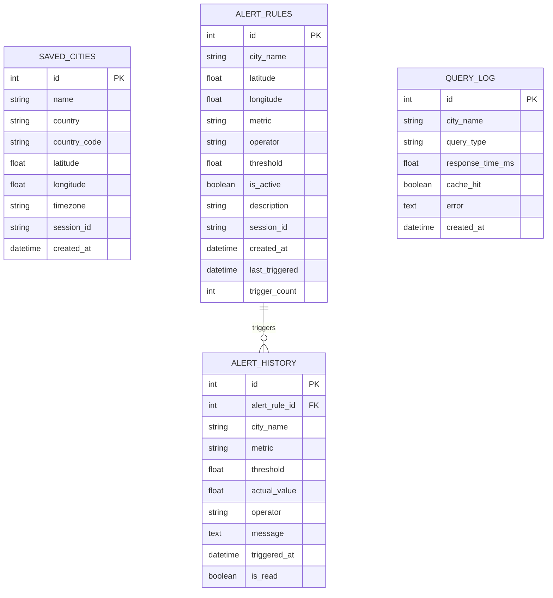

# AtmosphereX Architecture & System Design Documentation

## 1. System Overview

AtmosphereX is a cloud-native weather intelligence and climate analysis platform engineered using a modern microservices-style decoupled architecture. It separates stateless application workloads from distributed stateful backing services (PostgreSQL and Redis), fronted by high-performance reverse proxies and orchestrated using Kubernetes.

```mermaid
graph TD
    User([End User / Web Browser]) -->|HTTP / 3000| NGINX[NGINX Reverse Proxy / Frontend Pod]
    NGINX -->|Serves Static SPA| ReactApp[React + TypeScript + Vite SPA]
    NGINX -->|Proxies /api/*| FastAPIPool[FastAPI Backend Pod Pool]

    subgraph "Kubernetes Cluster / Minikube Namespace: atmospherex"
        subgraph "Ingress & Edge Routing"
            Ingress[NGINX Ingress Controller] --> NGINX
        end

        subgraph "Stateless Application Layer"
            FastAPIPool --> Pod1[Backend Pod 1]
            FastAPIPool --> Pod2[Backend Pod 2]
            FastAPIPool --> PodN[Backend Pod N (HPA Scaled)]
        end

        subgraph "Stateful & Cache Tier"
            Pod1 & Pod2 & PodN -->|Read/Write Session & Alerts| Postgres[(PostgreSQL 16 StatefulSet/PVC)]
            Pod1 & Pod2 & PodN -->|Cache Check & Store (TTL)| Redis[(Redis 7.4 In-Memory Cache)]
        end

        subgraph "Background Evaluation & Monitoring"
            Prometheus[Prometheus Server] -->|Scrapes /api/v1/metrics| FastAPIPool
            Grafana[Grafana 11 Dashboards] -->|Queries TSDB| Prometheus
            AlertWorker[APScheduler Worker] -.->|Evaluates Alert Thresholds| FastAPIPool
        end
    end

    subgraph "External Cloud Weather Providers"
        FastAPIPool -->|Async HTTP| OpenMeteoWeather[Open-Meteo Forecast API]
        FastAPIPool -->|Async HTTP| OpenMeteoArchive[Open-Meteo Historical Archive API]
        FastAPIPool -->|Async HTTP| OpenMeteoAQ[Open-Meteo Air Quality API]
        FastAPIPool -->|Async HTTP| OpenMeteoGeo[Open-Meteo Geocoding API]
    end
```

---

## 2. Cloud-Native Design Principles Applied

1. **Decoupled Stateless Frontend & Backend**:
   - The frontend is compiled into static production bundles and served via NGINX with zero server-side state.
   - The FastAPI backend does not maintain in-memory sessions across requests; state resides in Redis (caching) and PostgreSQL (durability). Any backend pod can service any request.

2. **Strict Twelve-Factor App Compliance**:
   - **I. Codebase**: One monorepo tracked in Git with multiple deployable targets.
   - **II. Dependencies**: Explicitly declared via `requirements.txt` and `package.json`.
   - **III. Config**: Environment variables injected via Kubernetes `ConfigMap` and `Secret` resources or Docker Compose `.env`.
   - **IV. Backing Services**: Attached resources (Postgres, Redis, Open-Meteo) configured as URLs.
   - **VI. Processes**: Stateless, share-nothing processes.
   - **VIII. Concurrency**: Horizontal scaling via Kubernetes `HorizontalPodAutoscaler` (HPA).
   - **IX. Disposability**: Fast startup and graceful shutdown via FastAPI `lifespan` context manager.
   - **X. Dev/Prod Parity**: Identical container images across local Docker Compose and Kubernetes.
   - **XI. Logs**: Output to `stdout` in structured format for collector aggregation.

3. **Multi-Tier Caching Architecture**:
   To avoid rate limits on upstream APIs and ensure sub-10ms response times for repeat queries:
   - **Geocoding queries**: Cached for 24 hours (`cache_ttl_geocode = 86400`).
   - **Current weather**: Cached for 10 minutes (`cache_ttl_current = 600`).
   - **Weather forecasts**: Cached for 30 minutes (`cache_ttl_forecast = 1800`).
   - **Air quality**: Cached for 15 minutes (`cache_ttl_air_quality = 900`).
   - **Historical / Climate data**: Cached for 6 hours (`cache_ttl_historical = 21600`).

4. **Graceful Degradation & Data Resilience**:
   If upstream weather services experience network partitions or timeouts:
   - Cached responses are returned with `cache_age_seconds` and visual warnings in the UI.
   - A deterministic **Data Reliability Score** (0-100%) dynamically scores response freshness and completeness.

---

## 3. Data & Storage Layer

### Entity Relationship Model



---

## 4. Scalability & Resilience Architecture

### Horizontal Pod Autoscaler (HPA)
- Autoscales the backend Deployment from a minimum of **2 replicas** up to **8 replicas** based on:
  - Average CPU utilization exceeding **70%**.
  - Average Memory utilization exceeding **80%**.
- Fast scale-up window (0 stabilization) with conservative scale-down stabilization (300 seconds) prevents flapping.

### Health & Readiness Probes
- **Liveness Probe** (`/api/v1/health`): Verifies application thread responsiveness.
- **Readiness Probe** (`/api/v1/ready`): Performs upstream dependency verification against PostgreSQL and Redis before accepting traffic through Kubernetes Service endpoints.
